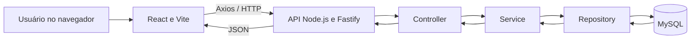

# 🖥️ TECHSTOCK

### Documentação — Situação de Aprendizagem I

**Sistema de Controle de Inventário de Equipamentos | TechSolutions | SENAI**

*Uma aplicação web para organizar, cadastrar e acompanhar equipamentos de tecnologia.*


</div>

---

## 📌 Sobre o projeto

O **TechStock** foi desenvolvido para a **Situação de Aprendizagem I** do curso de **Técnico em Desenvolvimento de Sistemas Web — SENAI**.

A empresa fictícia **TechSolutions** precisava de uma maneira mais organizada de acompanhar notebooks, monitores, mouses, teclados, headsets e acessórios. Em vez de depender exclusivamente de planilhas, a proposta é reunir os registros em uma aplicação com interface amigável e banco de dados.

**Objetivos de aprendizagem:** praticar o fluxo entre **React → API Node.js/Fastify → MySQL**, a organização do código em camadas, a navegação entre páginas e as operações de cadastro e consulta.

### ✨ Funcionalidades e telas

| Recurso | Descrição | Situação documentada |
|---|---|---|
| 📊 **Dashboard** | Visão geral do inventário, indicadores e área de cadastro. | Estrutura desenvolvida; integração depende da execução do backend. |
| 🧾 **Catálogo de ativos** | Listagem de equipamentos, situação, categoria e paginação. | Parte do projeto; conferir integração atual. |
| ➕ **Cadastro** | Formulário para inserir equipamentos. | Parte do fluxo principal do projeto. |
| 📑 **Relatório** | Área reservada a análises e informações consolidadas. | **Em desenvolvimento.** |
| 🔍 **Consultas** | Área de pesquisa e filtros. | **Em desenvolvimento.** |
| 🧭 **Primeira Versão** | Página para demonstrar a evolução do projeto. | Prevista na navegação. |
| 🚫 **NotFound (404)** | Tratamento visual de endereços inexistentes. | Página própria, sem Header e Footer. |


### 🧰 Tecnologias utilizadas

| Camada | Tecnologias / bibliotecas |
|---|---|
| **Frontend** | React, Vite, JavaScript, Styled Components, React Router, Axios |
| **Recursos adicionais do frontend** | React Hook Form e SweetAlert2 (conforme instalação no projeto) |
| **Backend** | Node.js, Fastify, dotenv, UUID (conforme instalação), driver de MySQL usado na conexão |
| **Banco de dados** | MySQL |
| **Ambiente** | VS Code; MySQL instalado localmente **ou** em container Docker independente |

---

## 1. CRIAÇÃO E MODELAGEM DO BANCO DE DADOS — SEM DOCKER

### 1.1. Queries utilizadas na criação

O arquivo [`banco_sql/01_techstock.sql`](./banco_sql/01_techstock.sql) contém a criação do banco e da tabela, além de **18 registros fictícios** para teste.

```sql
CREATE DATABASE IF NOT EXISTS techstock_db;
USE techstock_db;

CREATE TABLE IF NOT EXISTS equipamentos (
    id INT AUTO_INCREMENT PRIMARY KEY,
    nome VARCHAR(120) NOT NULL,
    categoria VARCHAR(60) NOT NULL,
    numero_serie VARCHAR(100) NOT NULL UNIQUE,
    status VARCHAR(50) NOT NULL,
    data_aquisicao VARCHAR(100) NOT NULL
);
```

#### Dicionário de campos

| Campo | Tipo | Finalidade |
|---|---|---|
| `id` | `INT AUTO_INCREMENT` | Identificador único, gerado pelo banco. |
| `nome` | `VARCHAR(120)` | Nome do equipamento. |
| `categoria` | `VARCHAR(60)` | Notebook, Monitor, Mouse, Teclado etc. |
| `numero_serie` | `VARCHAR(100) UNIQUE` | Número de série; não pode ser repetido. |
| `status` | `VARCHAR(50)` | Situação: disponível, emprestado ou manutenção. |
| `data_aquisicao` | `VARCHAR(100)` | Data de aquisição armazenada como texto no esquema atual. |

> **Escolha de modelagem:** `data_aquisicao` foi mantida como `VARCHAR(100)` para reproduzir a estrutura original do exercício. Em uma evolução futura, vale considerar o tipo `DATE`, ajustando também a API e os formulários. É recomendável padronizar os textos de `status` (por exemplo, `Disponivel` versus `Disponível`), pois diferenças de acentuação podem afetar os filtros.

---


## 2. INSTALAÇÃO E PREPARAÇÃO DO MYSQL COM DOCKER

> O nome do banco de dados é **`techstock_db`**, tanto na instalação local quanto no Docker. São instalações alternativas: cada uma mantém seus próprios dados.

### 2.1. Criar o container

```bash
docker run -d --name techstock -e MYSQL_ROOT_PASSWORD=123 -e MYSQL_DATABASE=techstock_db -p 3307:3306 mysql:8
```

Se o container **já tiver sido criado** com o nome `techstock`, basta iniciá-lo, sem executar `docker run` novamente:

```bash
docker start techstock
```

> `techstock` no parâmetro `--name` é o **nome do container**; `techstock_db` em `MYSQL_DATABASE` é o **nome do banco**. A senha `123` é apenas um exemplo didático para ambiente local.


**Significado das opções:**

| Opção | Significado |
|---|---|
| `-d` | Executa em segundo plano. |
| `--name techstock` | Nome do container. |
| `MYSQL_ROOT_PASSWORD=...` | Senha do usuário administrador do MySQL. |
| `MYSQL_DATABASE=techstock_db` | Cria a base `techstock` na inicialização de um volume novo. |
| `-p 3307:3306` | Porta `3307` do computador → porta `3306` do container. |
| `-v techstock_mysql_dados:/var/lib/mysql` | Guarda os arquivos do banco em volume persistente. |
| `mysql:8` | Imagem do MySQL, família 8. |


### 2.2. Acessar o container e o banco

```bash
# Ver containers em execução
docker ps

# Entrar no MySQL do container
docker exec -it techstock mysql -u root -p
```

No terminal do MySQL:

```sql
USE techstock_db;
```

### 2.3. Criar a tabela

```sql
USE techstock_db;

CREATE TABLE IF NOT EXISTS equipamentos (
    id INT AUTO_INCREMENT PRIMARY KEY,
    nome VARCHAR(120) NOT NULL,
    categoria VARCHAR(60) NOT NULL,
    numero_serie VARCHAR(100) NOT NULL UNIQUE,
    status VARCHAR(50) NOT NULL,
    data_aquisicao VARCHAR(100) NOT NULL
);
```

### 2.4. Inserir dados fictícios para teste

Selecione o banco `techstock_db` antes de inserir os registros fictícios.

```sql
-- Banco utilizado em ambas as instalações (local e Docker).
USE techstock_db;

INSERT INTO equipamentos (nome, categoria, numero_serie, status, data_aquisicao) VALUES
('MacBook Air M2', 'Notebook', 'TS-NB-001', 'Emprestado', '2026-02-10'),
('Dell Latitude 5440', 'Notebook', 'TS-NB-002', 'Disponivel', '2026-01-15'),
('Lenovo ThinkPad E14', 'Notebook', 'TS-NB-003', 'Manutenção', '2025-11-20'),
('Acer Aspire 5', 'Notebook', 'TS-NB-004', 'Disponivel', '2026-03-06'),
('Monitor LG UltraWide 29', 'Monitor', 'TS-MN-005', 'Disponivel', '2025-09-14'),
('Monitor Dell 24', 'Monitor', 'TS-MN-006', 'Emprestado', '2026-04-04'),
('Monitor Samsung 27', 'Monitor', 'TS-MN-007', 'Disponivel', '2026-03-18'),
('Monitor AOC 24', 'Monitor', 'TS-MN-008', 'Manutenção', '2025-08-07'),
('Mouse Logitech MX Master', 'Mouse', 'TS-MS-009', 'Emprestado', '2026-01-21'),
('Mouse Microsoft Bluetooth', 'Mouse', 'TS-MS-010', 'Disponivel', '2026-02-11'),
('Mouse Logitech M720', 'Mouse', 'TS-MS-011', 'Disponivel', '2025-12-03'),
('Teclado Logitech K380', 'Teclado', 'TS-TC-012', 'Emprestado', '2025-09-29'),
('Teclado Keychron K2', 'Teclado', 'TS-TC-013', 'Disponivel', '2026-04-13'),
('Headset HyperX Cloud', 'Headset', 'TS-HD-014', 'Disponivel', '2026-05-06'),
('Headset Jabra Evolve2', 'Headset', 'TS-HD-015', 'Manutenção', '2026-02-19'),
('Dock Station Dell WD19', 'Acessório', 'TS-AC-016', 'Emprestado', '2026-01-12'),
('Webcam Logitech C920', 'Acessório', 'TS-AC-017', 'Disponivel', '2025-10-23'),
('Hub USB-C Anker', 'Acessório', 'TS-AC-018', 'Disponivel', '2026-03-30');
```

> Os números de série são únicos: execute o `INSERT` apenas uma vez em cada banco, para evitar registros duplicados.

### 2.5. Consultas úteis

```sql
-- Listar todos os equipamentos
SELECT * FROM equipamentos;

-- Contar o total cadastrado
SELECT COUNT(*) AS total FROM equipamentos;
```

## 3. CRIAÇÃO E PREPARAÇÃO DO BACKEND

O backend é responsável por receber requisições HTTP, executar a lógica da aplicação e consultar o MySQL.

### 3.1. Iniciar o projeto e instalar dependências

No terminal, dentro da pasta `backend`:

```bash
npm init -y
npm install fastify uuid dotenv mysql2
```

No `backend/package.json`, configurar o tipo de módulo e o script de desenvolvimento:

```json
{
  "type": "module",
  "scripts": {
    "dev": "node --watch src/server.js"
  }
}
```

> O trecho acima mostra apenas as propriedades que devem estar no `package.json`; **mantenha as demais propriedades e dependências** que o npm criou.

### 3.2. Arquivos do backend

| Pasta/arquivo | Papel |
|---|---|
| 📁``src/controller/equipamentos-controller.js` | Recebe a requisição e devolve a resposta HTTP. |
| 📁``src/services/equipamentos-services.js` | Organiza regras e validações da operação. |
| 📁``src/repositories/equipamentos-repository.js` | Executa consultas e comandos SQL. |
| 📁``src/routes/equipamentos-routes.js` | Declara os endereços da API. |
| 📁``src/database/connection.js` | Configura a conexão com o MySQL. |
| 📁``src/app.js` | Monta e configura a aplicação Fastify, se assim estiver implementado. |
| 📁``src/server.js` | Inicia o servidor HTTP. |

O fluxo esperado é **rota → controller → service → repository → banco de dados**.

### 3.3. Rodar o backend

Na pasta `backend`:

```bash
npm run dev
```

Ou, sem o modo de observação de arquivos:

```bash
node src/server.js
```

## 4. FRONTEND

O frontend é construído com React e utiliza o Vite para iniciar o ambiente de desenvolvimento.

Se o projeto já possui um `package.json` configurado e compartilhado, normalmente basta executar **`npm install`**, sem reinstalar cada pacote separadamente.

Caso contrário, siga as instalações abaixo:

### 4.1. Instalar dependências

Na pasta `frontend`:

```bash
npm install styled-components
npm install react-router-dom
npm install axios
npm install react-hook-form
npm install sweetalert2
```

### 4.2. Rodar o frontend

```bash
npm run dev
```

Abra o endereço exibido pelo Vite — geralmente:

```text
http://localhost:5173

## 5. ESTRUTURA DE PASTAS E ARQUIVOS

Abaixo está a árvore organizada com as pastas e arquivos do TechStock. 

```text
📁 TechStock/
│
├── 📁 banco_sql/
│   └── 01_techstock.sql           # Criação e exemplos para o banco
│
├── 📁 frontend/
│   ├── 📁 public/
│   ├── 📁 src/
│   │   ├── 📁 components/
│   │   │   ├── 📁 Header/
│   │   │   │   ├── index.jsx
│   │   │   │   └── styled.jsx
│   │   │   ├── 📁 Footer/
│   │   │   │   ├── index.jsx
│   │   │   │   └── styled.jsx
│   │   │   ├── 📁 Logo/
│   │   │   │   ├── index.jsx
│   │   │   │   └── styled.jsx
│   │   │   ├── 📁 Banner/
│   │   │   │   ├── index.jsx
│   │   │   │   └── styled.jsx
│   │   │   ├── 📁 Cards/
│   │   │   │   ├── index.jsx
│   │   │   │   └── styled.jsx
│   │   │   ├── 📁 Catalogo/
│   │   │   │   ├── index.jsx     # Tabela e paginação
│   │   │   │   └── styled.jsx
│   │   │   └── 📁 Layout/
│   │   │       └── index.jsx     # Header + Outlet + Footer
│   │   │
│   │   ├── 📁 pages/
│   │   │   ├── 📁 PrimeiraVersao/
│   │   │   │   ├── index.jsx
│   │   │   │   └── styled.jsx
│   │   │   ├── 📁 Dashboard/
│   │   │   │   ├── index.jsx
│   │   │   │   └── styled.jsx
│   │   │   ├── 📁 Relatorio/
│   │   │   │   ├── index.jsx
│   │   │   │   └── styled.jsx
│   │   │   ├── 📁 Consultas/
│   │   │   │   ├── index.jsx
│   │   │   │   └── styled.jsx
│   │   │   └── 📁 NotFound/
│   │   │       ├── index.jsx
│   │   │       └── styled.jsx
│   │   │
│   │   ├── 📁 data/
│   │   │   └── equipamentos.js  # Dados de teste do frontend
│   │   ├── 📁 styles/
│   │   │   └── palette-azul.css # Paleta e gradientes
│   │   ├── router.jsx           # Definição das rotas (ou routes/router.jsx)
│   │   ├── App.jsx              # RouterProvider
│   │   ├── App.css
│   │   ├── index.css
│   │   └── main.jsx             # Inicialização do React
│   │
│   ├── index.html
│   └── package.json
│
├── 📁 backend/
│   ├── 📁 src/
│   │   ├── 📁 controller/
│   │   │   └── equipamentos-controller.js
│   │   ├── 📁 services/
│   │   │   └── equipamentos-services.js
│   │   ├── 📁 repositories/
│   │   │   └── equipamentos-repository.js
│   │   ├── 📁 routes/
│   │   │   └── equipamentos-routes.js
│   │   ├── 📁 database/
│   │   │   └── connection.js
│   │   ├── server.js
│   │   └── app.js
│   │
│   ├── package.json
│   └── .env                    # Configuração local (não versionar)
│
└── README.md
```

---

## 6. 🔄 Como o TechStock funciona



**Exemplo de consulta:** o usuário entra no Dashboard, o React envia uma requisição à API, o backend consulta o banco e devolve dados em JSON para preencher o Catálogo.

### Paginação: LIMIT e OFFSET

- **`LIMIT`**: quantos registros mostrar.
- **`OFFSET`**: quantos registros pular.
- **Fórmula**: `offset = (pagina - 1) * limite`.

Para a segunda página com 10 equipamentos por página:

```sql
SELECT * FROM equipamentos ORDER BY id LIMIT 10 OFFSET 10;
```

---

## 7. 🛣️ Rotas do frontend e API

### 7.1. Rotas do frontend

| Endereço | Página | Observação |
|---|---|---|
| `/` | Redireciona para `/dashboard` | Página inicial. |
| `/primeiraversao` | PrimeiraVersao | Apresentação da primeira versão; precisa estar registrada no router. |
| `/dashboard` | Dashboard | Conteúdo principal. |
| `/relatorio` | Relatorio | Em desenvolvimento. |
| `/consultas` | Consultas | Em desenvolvimento. |
| Qualquer caminho inválido | NotFound | Página 404 fora do Layout. |


---

**Projeto — Situação de Aprendizagem I | SENAI**
